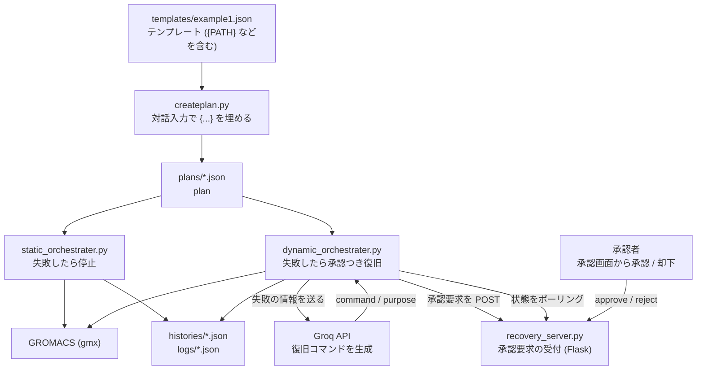
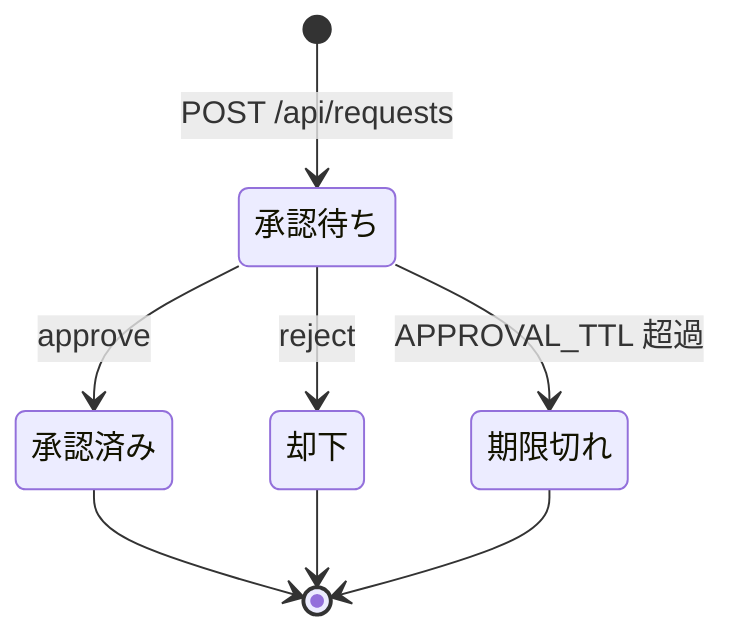

# gromacs-master_v2

GROMACS の分子動力学シミュレーションを、JSON で定義した**ノードのグラフ**として順番に実行するオーケストレーターです。

- ノードとその遷移(`次のノード`)を JSON (plan) で宣言する
- **static**: 失敗したらそこで停止する
- **dynamic**: 失敗したら LLM(Groq)が復旧コマンドを提案し、**人間の承認**を得てから実行する

## 全体像



## ファイル構成

| ファイル | 役割 |
|---|---|
| `createplan.py` | テンプレートの `{PATH}` などを対話入力で埋めて plan を生成する |
| `static_orchestrater.py` | plan を順に実行する。失敗したらそこで停止する |
| `dynamic_orchestrater.py` | 失敗時に Groq で復旧コマンドを生成し、承認されたら実行する |
| `recovery_server.py` | 復旧コマンドの承認要求を受け付ける Flask サーバー |
| `templates/example1.json` | タンパク質系の構築から平衡化・本番MD・解析までのテンプレート(22ノード) |
| `requirements.txt` | `Flask`, `flask-cors`, `groq` |

## 必要なもの

- Python 3.9 以上
- GROMACS(`gmx` が実行できること)
- dynamic を使う場合: Groq の API キー
- 承認画面をスマホ等から開く場合は、`recovery_server.py` を外部から到達できるようにする手段(Cloudflare Tunnel など)

```bash
pip install -r requirements.txt
```

## 使い方

### 1. plan を作る

テンプレート中の `{...}` を対話入力で埋めます。入力値に `"` や `\` が含まれていても JSON が壊れないようエスケープされます。

```bash
python3 createplan.py -t templates/example1.json -o plans/example.json
```

`-o` を省略すると `plans/<日時>.json` に出力されます。`example1.json` で入力するパラメータは次の 7 つです。

| パラメータ | 意味 |
|---|---|
| `PATH` | 作業ディレクトリ |
| `PDBID` | RCSB から取得する PDB ID |
| `GMX` | GROMACS の実行コマンド(例: `gmx`) |
| `WATER_MODEL` | `pdb2gmx -water` に渡す水モデル |
| `FORCE_FIELD` | `pdb2gmx -ff` に渡す力場 |
| `DISTANCE` | `editconf -d` に渡すボックス端までの距離 |
| `WATERBOXFILE` | `solvate -cs` に渡す水ボックスのファイル |


### 2. 復旧なしで実行する(static)

```bash
python3 static_orchestrater.py -p plans/example.json
python3 static_orchestrater.py -p plans/example.json -s nvt -e npt_pr
python3 static_orchestrater.py -p plans/example.json -ep /path/to/workdir
```

| オプション | 説明 |
|---|---|
| `-p`, `--plan` | plan の JSON(必須) |
| `-s`, `--start` | 開始ノード(省略時は先頭) |
| `-e`, `--end` | 終了ノード(省略時は末尾) |
| `-ep`, `--executionpath` | コマンドを実行するディレクトリ(省略時はカレント) |
| `--history` | history の出力先(省略時は `histories/<plan名>_<日時>.json`) |
| `-l`, `--logpath` | log の出力先(省略時は `logs/<plan名>_<日時>.json`) |

ノードが 0 以外の終了コードを返すか、`-e` のノードに到達すると停止します。

### 3. 承認つき復旧で実行する(dynamic)

`recovery_server.py` を先に起動してから、`dynamic_orchestrater.py` を実行します。

#### 復旧サーバー側

```bash
export RECOVERY_API_KEY="$(openssl rand -hex 32)"
export APPROVAL_URL="https://YOUR-USER.github.io/recovery_approval-v1/"
export APPROVAL_TTL=3600        # 任意。承認の有効期限(秒)
export CORS_ORIGINS="https://YOUR-USER.github.io"   # 任意。未設定なら APPROVAL_URL のオリジンのみ許可

python3 recovery_server.py                           # 127.0.0.1:5000 で起動
python3 recovery_server.py --offline                 # 0.0.0.0:5000 で起動 (LAN公開)
python3 recovery_server.py --offline --offline-port 8000   # ポート指定
```

| 環境変数 | 必須 | 説明 |
|---|---|---|
| `RECOVERY_API_KEY` | 必須 | サーバーの API キー。未設定だと起動時に終了する |
| `APPROVAL_URL` | 必須 | 承認画面の URL。コード上は CORS の既定オリジンを決めるためだけに使われる |
| `APPROVAL_TTL` | 任意 | 承認の有効期限(秒)。既定 `3600` |
| `PUBLIC_URL` | 任意 | 承認 URL に載せる、このサーバーの公開 URL。未設定なら受信したリクエストの URL(`X-Forwarded-Proto` と `Host`)から決める |
| `CORS_ORIGINS` | 任意 | 許可するオリジン(カンマ区切り)。未設定なら `APPROVAL_URL` のオリジン |

| 起動オプション | 説明 |
|---|---|
| `--offline` | `0.0.0.0` にバインドして LAN に公開する。省略時は `127.0.0.1` |
| `--offline-port` | 待ち受けポート(既定 `5000`)。`--offline` なしでも有効 |

本番運用では gunicorn でも起動できます(この場合 `--offline` / `--offline-port` は使えません)。

```bash
gunicorn -b 127.0.0.1:5000 recovery_server:app
```

インターネット経由で公開する場合は、別途トンネルを張ります。

```bash
cloudflared tunnel --url http://127.0.0.1:5000
```

#### オーケストレーター側

接続先は `--server-url` と `--offline-host` の**どちらか一方**を必ず指定します(両方・どちらも未指定はエラー)。

```bash
export RECOVERY_API_KEY="サーバーと同じ値"    # 復旧サーバーの API キー

# Cloudflare Tunnel などの URL を使う場合
python3 dynamic_orchestrater.py -p plans/example.json --api-key "gsk_..." \
    --server-url https://xxxx.trycloudflare.com

# LAN 内のサーバーを使う場合
python3 dynamic_orchestrater.py -p plans/example.json --api-key "gsk_..." \
    --offline-host 192.168.1.100 --offline-port 5000
```

static の `-p` `-s` `-e` `-ep` `--history` `-l` に加えて、次のオプションがあります。

| オプション | 既定値 | 説明 |
|---|---|---|
| `--api-key` | (必須) | **Groq の API キー**。復旧コマンドの生成に使う |
| `--recovery-api-key` | 環境変数 `RECOVERY_API_KEY` | **復旧サーバーの API キー**。`--recovery-api-key` は `ps` に見えるので、環境変数を推奨 |
| `--server-url` | なし | 復旧サーバーの URL(`--offline-host` と排他) |
| `--offline-host` | なし | 復旧サーバーのホスト。`http://<host>:<port>` として接続する(`--server-url` と排他) |
| `--offline-port` | `5000` | `--offline-host` 使用時のポート(1〜65535) |
| `--max-retries` | `3` | 1 ノードあたり、復旧コマンドを試す上限回数。次のノードへ進むとリセットされる |
| `--approval-timeout` | `3600` | 承認待ちを打ち切るまでの秒数 |
| `--approval-interval` | `5` | 承認状態を確認する間隔(秒) |

`-ep` の既定値は `.`(カレントディレクトリ)です。

## 復旧フロー

### 承認要求の状態

状態名は日本語で保存されます。`承認待ち` のときだけ承認・拒否でき、それ以外に操作すると HTTP 409 を返します。



期限切れは、`GET` した時、または approve / reject を試みた時に判定されます。

### 復旧サーバーの API

| メソッド | パス | 認証 | 説明 |
|---|---|---|---|
| `POST` | `/api/requests` | `X-API-Key` | 承認要求を作成する。body は `{"id", "command", "purpose"}`(すべて空でない文字列)。応答に `approval_url` を含む。不正なら 400、同じ `id` が既にあれば 409 |
| `GET` | `/api/requests/<id>` | `X-API-Key` または `X-Approval-Token` | `status` と `command` と `purpose` を返す。存在しなければ 404 |
| `POST` | `/api/requests/<id>/approve` | `X-Approval-Token` | `承認済み` にする |
| `POST` | `/api/requests/<id>/reject` | `X-Approval-Token` | `却下` にする |

承認 URL は `<APPROVAL_URL>#id=...&token=...&api=<サーバーURL>` の形です。トークンは `#` 以降(フラグメント)にあるので、承認画面のホスト先(GitHub Pages など)には送信されません。承認画面は読み取ったトークンを `X-Approval-Token` ヘッダーで送ります。

- APIキーでは承認・拒否できず、承認トークンはその 1 件の確認・承認・拒否だけに使えます。
- 認証に失敗すると 401 を返します。キー・トークンの比較は定数時間で行います。
- オーケストレーターは、承認されたコマンドが自分で提案したコマンドと一致することを実行前に確認します。

## 出力ファイル

history と log は同じ内容の JSON 配列で、1 コマンドにつき 1 要素です。**キー名は static と dynamic で異なります。**

static:

```json
{
  "ノード": "nvt",
  "実行コマンド": "...",
  "目的": "NVT平衡化を実行する",
  "出力": "...",
  "エラー": "...",
  "終了コード": 0
}
```

dynamic(復旧コマンドも同じ形式で追記されます):

```json
{
  "node": "nvt",
  "実行コマンド": "...",
  "目的": "NVT平衡化を実行する",
  "returncode": 0,
  "stdout": "...",
  "stderr": "..."
}
```

- static は停止時(`^C` を含む)に history と log を書き出します。`^C` で中断した場合の `終了コード` は `-2` です。
- dynamic は、コマンドを 1 つ実行するたびに history と log を上書き保存します。

## 終了コード

| 終了コード | static | dynamic |
|---|---|---|
| `0` | 最後のノード(または `-e` のノード)まで成功した | 同左 |
| `1` | ノードの失敗、plan の検証エラー | 承認が得られなかった、復旧コマンドが上限回数まで失敗した |
| `130` | `^C` で中断した | 同左 |

static は実行前に plan を検証し、次の場合はコマンドを実行せずにエラーで終了します。

- `-s` / `-e` に存在しないノード名を指定した
- `次のノード` が plan にないノードを指している
- `実行コマンド` / `目的` が文字列でないノードがある

dynamic も実行前に同じ検証を行います。さらに `-s` から `-e` まで `次のノード` をたどって到達できない場合(例: `-s b -e a`)もエラーになります。

## 注意事項

- ローカル環境での場合はターミナルで`ssh -L 5000:localhost:5000 desktop@123.45.6.78`を実行してサーバに接続してください。
- **コマンドは `shell=True` で実行されます。** plan と、承認した復旧コマンドは、全文を読んだ上で実行してください。信頼できない plan は実行しないでください。
- **失敗したコマンドと `stderr` が Groq に送信されます。** 秘匿したい情報が含まれていないか確認してください。
- LLM が生成した復旧コマンドは、承認画面に表示された内容がそのまま実行されます。承認者は全文を読んでください。
- 承認済みコマンドは、有効期限内なら何度でも `GET` で読み出せます(ワンタイム化はありません)。
- 承認トークンを間違えてもロックはかかりません。
- `pending_requests` はメモリ上にあるため、サーバーを再起動すると承認待ちの要求は失われます。
- `recovery_server.py` は Flask の開発サーバーで動きます。本番運用では gunicorn などを使ってください。
- `--offline` は HTTP(暗号化なし)で `0.0.0.0` に公開します。信頼できるネットワーク内でだけ使ってください。
- `example1.json` の `ref_p = 560` や本番MDの `nsteps = 50000000`(`dt = 0.002` で 100 ns)は、用途に合わせて確認してください。

## 既知の問題・未対応のこと

1. **承認画面([recovery_approval-v1](https://github.com/nakamura26002002921-a11y/recovery_approval-v1))との対応は未確認です。** 承認 URL の形式(`#id=...&token=...&api=...`)と、`X-Approval-Token` ヘッダーを送る前提は、承認画面側がこの API に対応している場合のみ動作します。
2. **コマンドの出力は、終了するまで表示されません。** 出力を `capture_output` で溜めるため、長い `mdrun` の途中経過は見えません。
3. **`{PATH}` などは `createplan.py` でクオートせずに埋め込まれます。** 空白を含むパスは、シェルで正しく扱えません。
